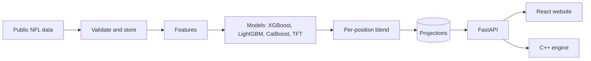

# Gridiron Oracle

Gridiron Oracle predicts how NFL players will perform, for one week or a whole season, and turns those predictions into fantasy football draft rankings.

## Goal

Give fantasy players and analysts projections they can trust because the method is tested honestly: every model is compared with simple baselines (last season, last three games, public draft rankings) using only information available before the game. The project also aims to turn the same projections into disciplined bet sizing (fractional Kelly with exposure limits) through the C++ engine. Betting is in scope.

## Who it is for

- Fantasy football players preparing a draft or choosing a weekly lineup.
- Analysts who want to see how good the projections really are.
- Developers who maintain the data and model pipeline.

See [docs/USERS.md](docs/USERS.md).

## What it does

- Collects public NFL data (nflverse via `nflreadpy`) into PostgreSQL.
- Builds features and trains four model types, combined by a small linear model per stat and position.
- Serves projections with ranges through a web API and a React website: weekly projections, season projections, a draft board with mock draft, a backtest page, and player pages.
- Includes a C++ engine for fast simulation and bet sizing. It is built and tested on its own.



Details: [docs/ARCHITECTURE.md](docs/ARCHITECTURE.md).

## Current State

Checked on 2026-10-07 by running the tests, not by trusting older documents.

| Check | Result |
|---|---|
| Backend tests (offline subset) | 1305 passed, 0 failed, 27 skipped |
| Frontend typecheck, 34 tests, build | all pass |
| C++ engine, 72 tests | all pass |
| Lint (`ruff` 0.15.12) | clean |
| Evidence manifest check | passes; every entry is marked "provisional" |

Re-run on 2026-10-07 after fixing the earlier failures: backend 1305 passed, 27 skipped, 0 failed; `ruff check .` clean; frontend typecheck, 34 tests and build pass; engine 72/72; evidence manifest OK.

**Model quality.**
- Owner-verified claim: on causal out-of-fold evaluation (15 stat/position cells, seasons 2021 to 2025), the model beat both the naive (last season) and trailing-3-games baselines in 74 of 75 cell-seasons. **Reproduction artifact not committed.** A per-cell eval CSV set for the current candidate is not in the repo.
- How to reproduce: for each cell, run `python -m ml.eval_causal --oof <pinned stack CSV from releases/current_baseline.json> --stat <stat> --position <pos> --out <csv>` (needs the database for baselines), then count rows where `beats_naive` and `beats_trailing3` are both true per cell-season. `scripts/summarize_causal_evals.py` does that aggregation but is hard-coded to older file names.
- History: in August 2026 an audit found a data leak; one report records the earlier headline falling from 74/75 to 15/75 after the fix, and the manifest labels all evidence "provisional". The 74/75 figure above is the owner-verified result on the rebuilt candidate.
- Committed, directly readable: `reports/marcel_vs_stack.json` (fantasy points only) has 16 scored position-season cells; the model beat naive and trailing-3 in all 16 and the Marcel baseline in 15.
- Against draft rankings (ADP), an earlier analysis (archived, not re-checked) found the model ranks players better across positions but worse within a position.

**Partly built:** season projections (an earlier note says ranges were too narrow); the draft board; the user settings page (saved weights have no consumer in the projection code that we found).

**Not verified:** live deployment health, the Railway cron refresh, the Bayesian/Monte Carlo layer on the served path, engine connection to any live odds feed, accuracy of the drive simulator.

**Known UI gaps:** the weekly "no forecast" banner has a hard-coded 2026 message; `Dashboard.tsx` and `SeasonProjections.tsx` are not reachable from any route; the player page shows "Book Line 0" when no line exists.

## Run it

```bash
make bootstrap-local            # Python env and git hooks
make up                         # docker stack: Postgres, MLflow, API, frontend
cd frontend && npm run dev      # or use .claude/launch.json
```

Tests and commands are listed in [AGENTS.md](AGENTS.md). On Apple Silicon set `KMP_DUPLICATE_LIB_OK=TRUE` and `OMP_NUM_THREADS=1` before ML code.

Releases: `releases/README.md`. Evidence policy: `releases/artifacts/README.md`.

## Layout

`scraper/` sources, `pipeline/` ETL and features, `ml/` models, `backend/` API and tests, `frontend/` website, `engine/` C++, `releases/` pinned artifacts, `reports/` evaluation outputs, `infra/` docker and monitoring, `scripts/` jobs.

## License

PolyForm Noncommercial 1.0.0 ([LICENSE](LICENSE)). Commercial use needs a separate license. Security reports: [SECURITY.md](SECURITY.md).
