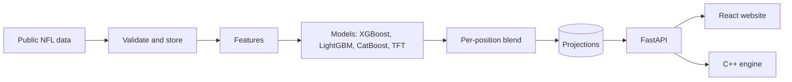

# Gridiron Oracle

Gridiron Oracle predicts how NFL players will perform, for one week or a whole season, and turns those predictions into fantasy football draft rankings.

## Goal

Give fantasy players and analysts projections they can trust because the method is tested honestly: every model is compared with simple baselines (last season, last three games, public draft rankings) using only information available before the game. The project also aims to turn the same projections into disciplined bet sizing (fractional Kelly with exposure limits) through the C++ engine. Betting is in scope.

## Who it is for

- Fantasy football players preparing a draft or choosing a weekly lineup.
- Analysts who want to see how good the projections really are.
- Developers who maintain the data and model pipeline.

See [docs/USERS.md](docs/USERS.md).

## What it does

- Collects public NFL data (nflverse via `nflreadpy`) into PostgreSQL.
- Builds features and trains four model types, combined by a small linear model per stat and position.
- Serves projections with ranges through a web API and a React website: weekly projections, season projections, a draft board with mock draft, a backtest page, and player pages.
- Includes a C++ engine for fast simulation and bet sizing. It is built and tested on its own.

Details: [docs/ARCHITECTURE.md](docs/ARCHITECTURE.md).

## License

PolyForm Noncommercial 1.0.0 ([LICENSE](LICENSE)). Commercial use needs a separate license. Security reports: [SECURITY.md](SECURITY.md).

## More

- Current status and next steps: [docs/status/CURRENT.md](docs/status/CURRENT.md)
- Setup, run, test, and architecture notes: [docs/DEVELOPMENT.md](docs/DEVELOPMENT.md)
- All docs: [docs/README.md](docs/README.md)
